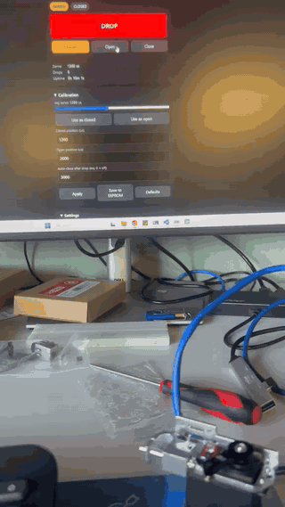

# MG996R Servo Payload Release – Teensy 4.1

Web-controlled payload release using an MG996R servo and a Teensy 4.1 over Ethernet.

## Wiring
| Servo  | Connect to |
|--------|-----------|
| Orange | Teensy pin 9 |
| Red    | External 5–6 V supply |
| Brown  | Supply GND + Teensy GND |

## Use
1. Upload `PayloadRelease/PayloadRelease.ino` (Board: Teensy 4.1).
2. Plug in Ethernet and open **http://192.168.2.50**.
3. Click **Arm**, then **DROP**.

`ServoTest/ServoTest.ino` is a simple test sketch that sweeps the servo, for checking the wiring.
